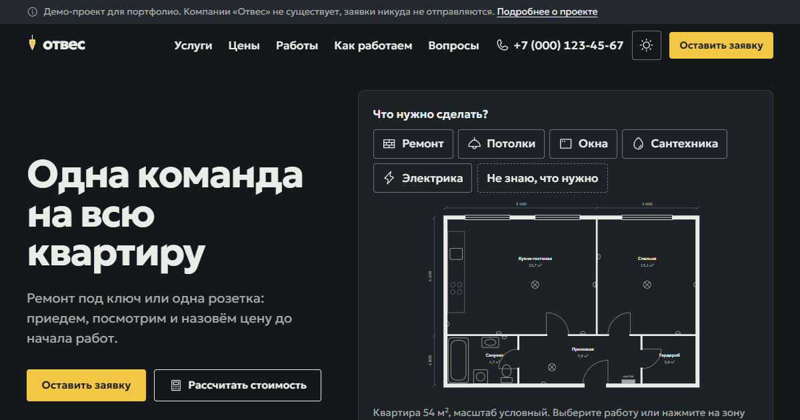

# «Отвес»: сайт ремонтной компании (демо для портфолио)

Сайт: https://mikerka1.github.io/otves/ · репозиторий: https://github.com/MIKERKA1/otves

Сайт вымышленной компании, которая делает ремонт квартир, натяжные потолки, окна, сантехнику и электрику. Компании не существует, заявки никуда не отправляются, и сайт говорит об этом прямо.



## Что внутри

- **План квартиры на первом экране.** Выбираете работу, и на чертеже подсвечивается, где она делается.
- **Услуги со своей логикой:** уровни ремонта (что входит, а что нет), фактуры потолка на макете комнаты, разрез монтажного шва окна, прайс сантехника, масштаб работ электрика.
- **Помощник «не знаю, что нужно»:** проблема, симптом, мастер, срок, цена, что сделать до приезда, заявка с готовым описанием.
- **Калькулятор:** диапазон цен, состав, что не входит, оговорка про ориентир, передача расчёта в заявку.
- **«До/после»** на настоящей паре фото одного ремонта, совмещённой по геометрии, и демо-кейсы в диалогах.
- **График работ** для трёх сценариев и пункты договора с пояснениями простыми словами.
- **Форма заявки** с проверкой фото по содержимому, удалением метаданных и согласием, которое не отмечено заранее.
- **Cookie и данные:** баннер с равноценными «разрешить» и «отклонить», настройки, необязательный модуль статистики грузится только после согласия, страница, где видно и удаляется всё, что сайт хранит.
- Страницы услуг, политика конфиденциальности, политика cookie, условия использования, «Ваши данные», «О демо-проекте», 404.

## Стек

Astro 7 (статическая сборка, TypeScript strict), Anime.js 4, Motion 14, шрифт Geologica, иконки Phosphor. Без UI-фреймворка и без сторонних запросов. Почему так и что отвергли, написано в [docs/concept.md](docs/concept.md).

## Запуск

Нужен Node.js 22.12 или новее.

```bash
npm install
npm run dev         # http://localhost:4321
npm run build       # проверка типов и сборка в dist/
npm run preview     # продакшен-сборка на http://localhost:4321
```

Тесты:

```bash
npm run test:unit   # формулы калькулятора, проверка фото и телефона (node:test)
npm run test:e2e    # Playwright + axe на продакшен-сборке, десктоп и телефон
npm test            # всё по очереди
```

На Windows e2e идут в Microsoft Edge. На других системах сначала выполните `npx playwright install chromium` или задайте канал через `PW_CHANNEL=chrome`.

## Переменные окружения

| Переменная | Зачем |
|---|---|
| `SITE_URL` | адрес сайта для canonical, sitemap, robots.txt и Open Graph |
| `BASE_PATH` | префикс, если сайт лежит не в корне домена, например `/otves` на GitHub Pages. По умолчанию `/` |
| `PUBLIC_STATS_ENDPOINT` | необязательно: куда отправлять обезличенные события статистики, если посетитель согласился. Без неё счётчики остаются в браузере |

## Деплой

После `git push` в ветку `main` GitHub Actions собирает сайт и выкладывает его на GitHub Pages (`.github/workflows/deploy.yml`), `SITE_URL` и `BASE_PATH` подставляются сами.

Результат сборки это статические файлы в `dist/`, подойдёт любой статический хостинг. CSP уже встроен в каждую страницу meta-тегом. Для Netlify и Cloudflare Pages в `public/_headers` лежат заголовки, которые нельзя задать meta-тегом (`frame-ancestors`, HSTS и другие).

## Структура

```
src/
  data/        контент и цены: услуги, помощник, кейсы, график, FAQ, формулы калькулятора
  lib/         хранилище, согласие, статистика, движение, проверка фото и телефона
  components/  шапка, подвал, баннер cookie, форма, FAQ, интерактивы услуг
    home/      секции главной
    service/   интерактивы, общие для главной и страниц услуг
  layouts/     базовый шаблон и шаблон документов
  pages/       главная, /uslugi/<id>/, документы, robots.txt
tests/
  unit/        node:test
  e2e/         Playwright
docs/
  concept.md   исследование, концепция, структура, архитектура данных
  audit.md     SDK, потоки данных, безопасность, доступность, производительность, тесты
```

## Что настоящее, а что нет

Настоящие: фотографии ремонта (immo RENOVATION, Unsplash), работа калькулятора, помощника, формы, баннера cookie и удаления данных. Придуманы: компания, телефон (код +7 (000) никому не выдан), почта (домен `.example`), цены, сроки, кейсы, отзывы.

## Лицензии

Код: MIT. Фото: [immo RENOVATION](https://unsplash.com/@immorenovation), лицензия Unsplash. Geologica: SIL OFL 1.1. Phosphor Icons, Anime.js, Motion, Astro: MIT.
